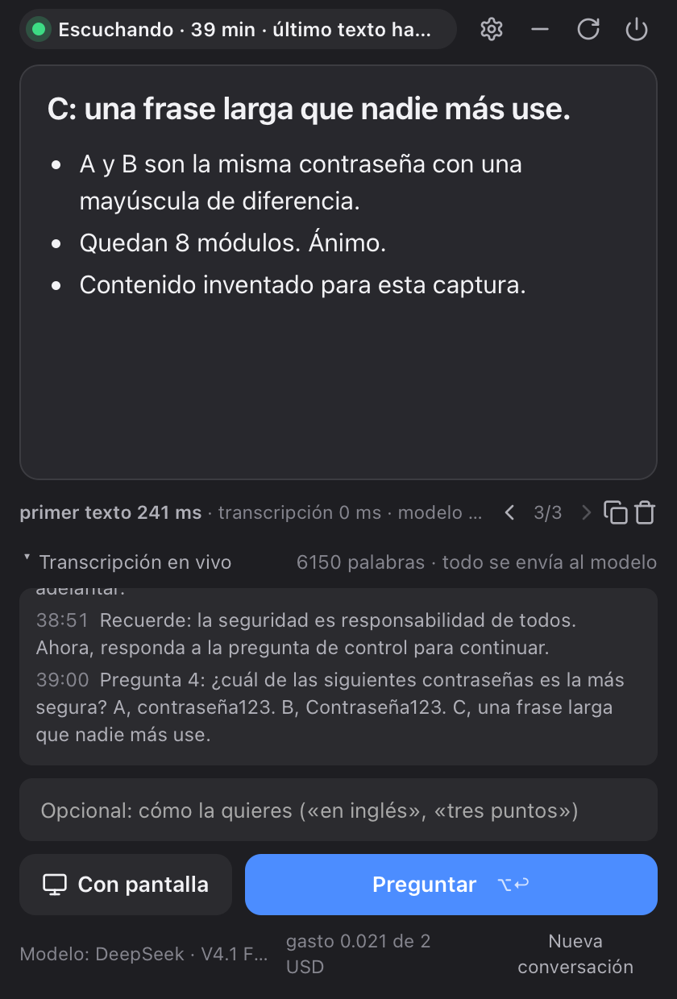
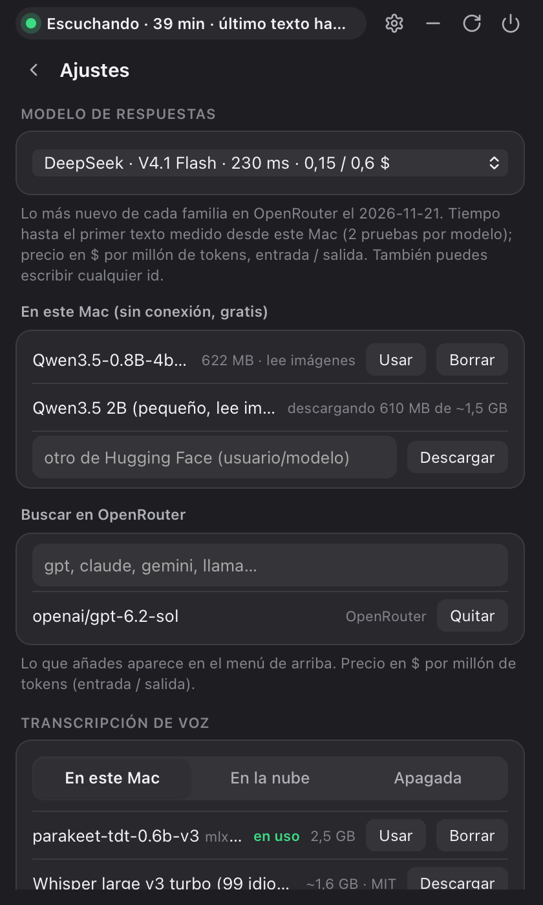
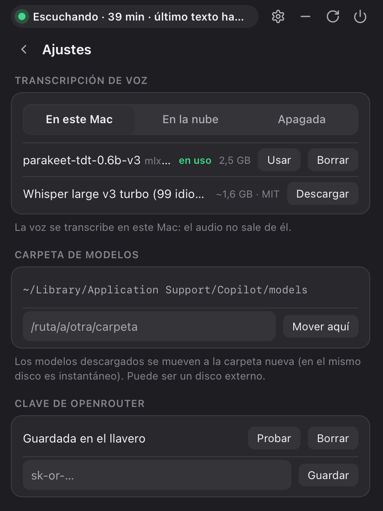

# Udummy

> A small floating panel that sits through the mandatory training video so your soul doesn't have to.

You know the one. **Module 7 of 12: Cybersecurity for Everyone.** Forty-five minutes. The seek bar is disabled, because adults cannot be
trusted to skip a slide that says *security is everyone's responsibility*. Every eleven minutes a quiz pops up to check you are still
alive, asking whether `password123` or `Password123` is the stronger password. You will do this again next year. The certificate goes
into a folder nobody has ever opened.

**Udummy listens along, and when the quiz shows up, you press one key.**

<p align="center"></p>

> **Read this first.** Udummy is for boring corporate e-learning: the mandatory click-through modules nobody remembers by Friday.
> It is **NOT** for exams, certifications, job interviews or anything proctored or graded where honesty is the point.
> **You are responsible for following your employer's rules**, and for what you send to a third-party model.

## How it works, in three steps

| 1. Open it | 2. Let the module play | 3. Ask |
|---|---|---|
| A small panel appears in the top-right corner, above other windows. | It transcribes what your Mac plays (not your microphone). | Press **⌥↩** (Option + Return) from any app, or **Preguntar**. The answer streams in. |

- **Audio, screen or both.** In Ajustes choose what a question sends: the transcript, a screenshot of the screen (for quizzes that are only
  on screen), or both.
- **Steer it.** Type "solo la letra", "en inglés" or "tres puntos" in the box before asking. The text stays for the next question.
- **Hide it.** The `–` button hides the panel; **⌥↩** brings it back. With **Oculto al compartir pantalla**, people you share your screen
  with don't see it. You do.

## Install (about 5 minutes)

You need a Mac with Apple silicon (M1 or newer), macOS 14.2 or newer, Python 3.11+ and Apple's command line tools
(`xcode-select --install` if you have never installed them).

```sh
git clone <this repo> && cd <this repo>
./install.sh
```

The installer puts everything in `~/Library/Application Support/Copilot` (its own Python environment, settings, logs and models) and the
app in `~/Applications/Copilot.app`. Nothing is installed system-wide. Open **Copilot** from `~/Applications` (drag it to the Dock if you
like). The first time, macOS asks to let Copilot record **system audio** and, if you use the screen mode, the **screen**: allow both.
The app is not notarised, so the first time you may need right-click › Open.

Uninstall: `./uninstall.sh` (add `--key` to also remove your OpenRouter key from the keychain).

## Pick your models (Ajustes › the gear)

<p align="center"></p>

**Answers.** Two ways, and you can switch any time:

- **OpenRouter** (fast, a fraction of a cent per question): paste your key from [openrouter.ai/keys](https://openrouter.ai/keys) under
  **Clave de OpenRouter**. It is kept in the macOS Keychain, never in a file, and **Probar** checks it without spending anything. The menu
  offers **Más rápido** and **Más barato** (picked automatically, with the measured time and the price), the newest model of each big
  family, and anything you find with **Buscar en OpenRouter**.
- **On this Mac** (free, offline, slower): **Descargar** a small model, or type any MLX model from Hugging Face (`user/model`), then
  **Usar**. Models that read images can also answer about the screen. The first answer after starting is slow while the model loads.

**Voice.** Under **Transcripción de voz**: **En este Mac** (download Parakeet or Whisper once; the audio never leaves the Mac),
**En la nube** (each chunk of audio goes to a speech model on OpenRouter with your key), or **Apagada** (screen-only mode).

<p align="center"></p>

**Models folder.** Models are big. Under **Carpeta de modelos** point it at another folder or an external disk and press **Mover aquí**:
everything already downloaded moves with it.

## What leaves your Mac

Only when you ask, and only to the provider you chose:

| | On this Mac | OpenRouter |
|---|---|---|
| Transcript | stays (local voice model) | each audio chunk, if you chose cloud voice |
| Your question | stays (local answer model) | the transcript, what you typed and, in screen mode, one screenshot |
| Stored on disk | settings, a log of sizes and timings (no content), downloaded models | nothing |

Transcript, screenshots and answers live in memory and are gone when you quit. The key lives in the Keychain.

## Rough edges

- The interface is in Spanish (for now).
- Speakers are not told apart. Music gets transcribed as eagerly as the narrator.
- **Oculto al compartir pantalla** uses macOS's own flag for windows that must not be captured. Most sharing tools respect it; not every
  one has been tested.
- Local answer models need memory: a 0.8B model peaks at about 1.2 GB; the first load from a slow disk can take a couple of minutes.
- Bigger local models work too, if your Mac has room. Inkling-2-Mini (2.5-bit MLX build, 11 GB) needs about **15 GB free** and an
  mlx-vlm newer than 0.8.0; on a 48 GB Mac it loaded in about 2 minutes and answered at about 39 tokens/s, but don't run it next to
  other heavy work. The default suggestion stays the small Qwen3.5.
- Every rebuild of the app (`./install.sh` again) makes macOS ask for the permissions again.

## For tinkerers

`run.sh` starts the engine and the panel from a terminal; `python test_settings.py` runs the engine tests (no window, no audio, no network);
`python test_local_llm.py <model folder>` times a local answer model. The panel is plain HTML/JS in `ui/`; the native shell is one Swift file
in `shell/`.

---

Made out of spite and boredom, mostly during Module 9. MIT licence.
